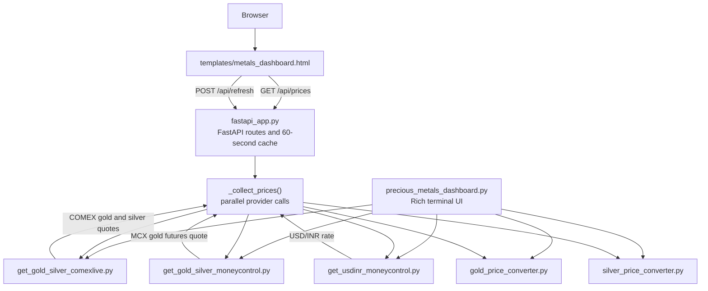

# Gold Info Web Architecture

This repository is a small Python application for precious-metals prices. It
has two user interfaces over the same quote and calculation modules:

- A browser dashboard served by FastAPI.
- A terminal dashboard rendered with Rich.

The Git repository tracks the root-level gold and silver app. Other
untracked directories in the working folder are separate local content and
are outside this architecture guide.

## System overview



The FastAPI and terminal interfaces reuse the source and conversion modules.
The browser UI does not fetch providers directly; it calls the JSON API.

## Browser application

### Entry point

`fastapi_app.py` creates the FastAPI object named `app`. Start it from the
repository root using either:

```bash
python fastapi_app.py
```

or:

```bash
uvicorn fastapi_app:app --host 127.0.0.1 --port 8000
```

The browser dashboard is at `http://127.0.0.1:8000/`.

### Request and refresh flow

1. `GET /` serves `templates/metals_dashboard.html`.
2. The page JavaScript requests `GET /api/prices` on load.
3. The user can click **Refresh prices**, which calls `POST /api/refresh`.
4. The API fetches COMEX, USD/INR, and MCX gold independently and in parallel
   using a thread pool. These existing fetchers make synchronous HTTP calls.
5. Successful quotes are normalized to JSON-compatible dictionaries.
6. COMEX gold and silver are converted to INR and after-tax values only when
   both the COMEX quotes and USD/INR rate are available.
7. The result includes an update time, quote data, and per-source errors. The
   response is held in an in-process cache for 60 seconds. A manual refresh
   bypasses the cache.
8. The page renders quote cards, the provider name, and any source warnings.

If all main sources fail to provide USD/INR, COMEX gold, and MCX gold, the API
returns HTTP 503 with error details. A partial response is returned when at
least one of those sources succeeds.

### API shape

- `GET /api/prices` — return cached prices or fetch them if the cache is stale.
- `POST /api/refresh` — force a new fetch and replace the cache.

Each successful response has this general shape:

```json
{
  "updated_at": "UTC timestamp",
  "usd_inr": {"rate": 94.0, "source": "provider"},
  "comex_gold": {"last": 3900.0, "inr_10g": 0.0},
  "comex_silver": {"last": 50.0, "inr_kg": 0.0},
  "mcx_gold": {"last": 136750.0, "source": "Economic Times"},
  "errors": {}
}
```

Quote fields depend on which source data is available. The numerical values in
this example are illustrative, not hard-coded app data.

## Price providers and calculations

| Module | Responsibility |
| --- | --- |
| `get_gold_silver_comexlive.py` | Fetches COMEX page data and extracts gold and silver last prices, changes, closes, highs, lows, and trade times. It supports multiple parsing paths. |
| `get_gold_silver_moneycontrol.py` | Fetches the MCX gold futures quote and Moneycontrol silver quote. MCX gold falls back to Economic Times if Moneycontrol fetch or parsing fails. |
| `get_usdinr_moneycontrol.py` | Fetches USD/INR from Moneycontrol and falls back to a dated reference rate from exchangerate-api.com when needed. |
| `gold_price_converter.py` | Converts USD/troy-ounce gold to INR/10g and applies the configured 15% gold import duty plus 3% GST. |
| `silver_price_converter.py` | Converts USD/troy-ounce silver to INR/kg and applies the configured 6% silver import duty plus 3% GST. |

MCX gold is a futures contract quote in INR per 10g. COMEX quotes are
international prices converted using USD/INR; they are a separate market
measure and should not be represented as an MCX contract price.

External websites may block requests or change their markup. The app preserves
individual source errors in the API response so the UI can show a warning
without discarding successful quotes from other providers.

## Terminal dashboard

`precious_metals_dashboard.py` is the original Rich interface. Run it from
the repository root:

```bash
python precious_metals_dashboard.py
```

It calls the same quote providers and conversion helpers as the FastAPI
application, then prints panels and comparison/summary tables in the terminal.

## Dependencies and configuration

- `requirements.txt` contains the root app dependencies. FastAPI and Uvicorn
  are required for the browser dashboard; Rich is used by the terminal
  dashboard.
- The app has no database. Browser quote results are cached in process memory;
  restarting the server clears this cache.
- Provider URLs, HTTP headers, and parsing logic are defined in the relevant
  `get_*.py` modules.
- A working network connection is required to retrieve current quotes.

## Where to make changes

- Browser card layout, styling, refresh button, or rendering:
  `templates/metals_dashboard.html`.
- API routes, payload shape, cache, source errors, or parallel fetching:
  `fastapi_app.py`.
- COMEX quote source or parsing: `get_gold_silver_comexlive.py`.
- MCX gold fallback or Moneycontrol silver parsing:
  `get_gold_silver_moneycontrol.py`.
- USD/INR parsing and fallback: `get_usdinr_moneycontrol.py`.
- Gold/silver unit conversion or tax math:
  `gold_price_converter.py` and `silver_price_converter.py`.
- Terminal-specific layout and orchestration:
  `precious_metals_dashboard.py`.
- Install/runtime dependencies: `requirements.txt`.
