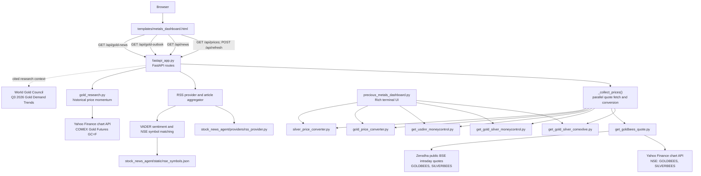

# AuricAI Architecture

AuricAI is a Python application with a FastAPI browser dashboard and a
Rich terminal dashboard. The browser presents COMEX precious-metal quotes, MCX commodity contracts,
Nippon India Gold BeES and Silver BeES prices from NSE and Zerodha's BSE
listing, USD/INR, RSS headlines with related-stock sentiment, and a gold-market
research panel.

## System overview



The browser does not call market-data providers directly; the FastAPI
application owns provider calls and prepares JSON responses. News and gold
research load independently from the quote cards so failure in one section
does not hide the others.

## Browser application

### Entry point and run

`fastapi_app.py` creates the FastAPI application object `app`. Run from the
repository root after building the Tailwind stylesheet:

```bash
npm install
npm run build:css
python fastapi_app.py
```

Or use Uvicorn:

```bash
uvicorn fastapi_app:app --host 127.0.0.1 --port 8000
```

Open `http://127.0.0.1:8000/`.

### Routes

| Route | Purpose |
| --- | --- |
| `GET /` | Serves `templates/metals_dashboard.html`. |
| `GET /static/tailwind.css` | Serves the locally compiled Tailwind stylesheet. |
| `GET /api/prices` | Returns cached quotes or fetches a new set when the 60-second cache expires. |
| `POST /api/refresh` | Forces a new parallel quote fetch and refreshes the in-process cache. |
| `GET /api/news` | Fetches, deduplicates, and filters recent RSS news; adds VADER sentiment and related NSE stocks. |
| `GET /api/gold-outlook` | Returns COMEX gold futures momentum and cited long-term demand research. |
| `GET /api/gold-news` | Returns recent Google News RSS results matching gold-market terms with VADER headline sentiment. |

The UI uses Tailwind utility classes for layout, spacing, and responsive
behavior. `static/tailwind.input.css` and `tailwind.config.js` are the build
inputs; `npm run build:css` writes the stylesheet served at `/static/tailwind.css`.

### Quote flow

1. The dashboard requests `/api/prices` when the page loads.
2. `_collect_prices()` invokes COMEX, USD/INR, MCX Gold, MCX Silver, MCX
   Crude Oil, and NSE/Zerodha quote fetchers for Gold BeES and Silver BeES in
   a thread pool.
3. Each provider error is logged and included by source key in the response;
   successful providers still contribute data.
4. COMEX gold and silver are converted to INR only when a positive USD/INR
   rate is available. Configured duty/GST estimates are calculated separately.
5. MCX crude oil is quoted in INR per barrel by Economic Times. The API also
   derives a USD-per-barrel equivalent by dividing the quote and its available
   price fields by the USD/INR rate. This is a currency conversion of the MCX
   contract, not a WTI or Brent quote.
6. Gold BeES and Silver BeES are each fetched from Yahoo Finance for the NSE
   ticker and from Zerodha's public BSE intraday endpoint linked from each
   `BSE/<symbol>` ETF page. The exchange listings can have different price
   snapshots.
7. The result is cached in memory for 60 seconds. Restarting the process
   clears the cache.

The partial-response check returns HTTP 503 only if all supported quote data
is unavailable; otherwise the API returns available data plus provider errors.

### Price response shape

The price response includes these top-level fields:

```json
{
  "updated_at": "UTC timestamp",
  "usd_inr": {"rate": 94.0, "source": "provider"},
  "comex_gold": {"last": 3900.0, "inr_10g": 0.0},
  "comex_silver": {"last": 50.0, "inr_kg": 0.0},
  "mcx_gold": {"last": 136750.0, "unit": "INR per 10g"},
  "mcx_silver": {"last": 176500.0, "unit": "INR per kg"},
  "mcx_crude_oil": {
    "last": 8300.0,
    "unit": "INR per barrel",
    "usd_last": 88.0,
    "usd_inr_rate": 94.0
  },
  "goldbees": {"last": 112.0, "source": "Yahoo Finance · NSE"},
  "zerodha_goldbees": {"last": 112.07, "source": "Zerodha · BSE"},
  "silverbees": {"last": 168.85, "source": "Yahoo Finance · NSE"},
  "zerodha_silverbees": {"last": 168.81, "source": "Zerodha · BSE"},
  "errors": {}
}
```

Fields are omitted or `null` when the source or a dependent conversion is
unavailable. The numbers above are illustrative; NSE and BSE values come from
separate quote providers and can differ.

## News and stock sentiment

`GET /api/news` calls the RSS provider in the stock-news package, merges and
deduplicates items, keeps items from the previous seven days, and returns at
most 12 articles.

For each article, `fastapi_app.py`:

1. Scores its title and summary with NLTK VADER. The analyzer is initialized
   once; the `vader_lexicon` is downloaded on first use if absent.
2. Matches company names and unambiguous uppercase ticker symbols against the
   NSE symbol list in `stock_news_agent/static/nse_symbols.json`.
3. Returns the sentiment label and compound score, plus matched stocks.
4. Aggregates average compound sentiment and article count per matched stock.

The UI shows article sentiment, related ticker tags, and up to eight
stock-level summaries. Sentiment is a text signal, not a price prediction or
investment recommendation.

### Stock-news deployment dependency

The app imports `stock_news_agent.aggregator` and
`stock_news_agent.providers.rss_provider`, and reads its NSE symbols JSON file.
Those files are required for the news/sentiment feature. In the current local
worktree, `stock_news_agent/` is untracked by Git, so it is not included in
commits or a fresh clone unless it is separately added or otherwise provided.
Ensure that package and its `static/nse_symbols.json` data file are present in
the deployment before starting FastAPI. The root `requirements.txt` includes
the required `nltk` runtime dependency; install dependencies with:

```bash
python -m pip install -r requirements.txt
```

## Gold outlook and research

`gold_research.py` requests one year of daily COMEX Gold Futures (`GC=F`)
history from the Yahoo Finance chart API. It calculates:

- Short-term momentum over the latest five trading sessions.
- One-month momentum over 21 trading sessions.
- Long-term momentum over approximately 252 trading sessions when sufficient
  history is available.

These are historical close-to-close percentage changes, not forecasts. The
API also includes a sourced research summary from the World Gold Council's Q3
2026 Gold Demand Trends report: central-bank and ETF demand are listed as
supporting factors, while high prices' effect on jewellery and bar/coin demand
are noted as headwinds. Interest rates, the US dollar, ETF/central-bank flows,
and geopolitical/fiscal risks are listed as watch factors. Research is static
content in `fastapi_app.py`; price momentum is fetched live when the endpoint
is requested.

`GET /api/gold-outlook` returns update time, instrument and data timestamp,
period returns, source links, research factors, and a disclaimer. If Yahoo
Finance history is unavailable, the endpoint responds with HTTP 503 and the
dashboard reports that the outlook could not be loaded.

The outlook grid's fourth card shows up to eight gold-related headlines from a
Google News RSS search, each linked to its publisher and labeled with VADER
headline tone. Sentiment is informational and is not a gold-price forecast.

## Providers and calculations

| Module | Responsibility |
| --- | --- |
| `get_gold_silver_comexlive.py` | Fetches and parses COMEX gold and silver quotes. |
| `get_goldbees_quote.py` | Fetches Yahoo Finance NSE and Zerodha public BSE quotes for Gold BeES and Silver BeES. |
| `get_gold_silver_moneycontrol.py` | Fetches MCX Gold (Moneycontrol with Economic Times fallback), Moneycontrol Silver for the terminal UI, MCX Silver (Economic Times), and MCX Crude Oil (Economic Times). |
| `get_usdinr_moneycontrol.py` | Fetches USD/INR from Moneycontrol with a reference-rate fallback. |
| `gold_price_converter.py` | Converts USD/troy-ounce gold to INR/10g and calculates configured duty/GST estimates. |
| `silver_price_converter.py` | Converts USD/troy-ounce silver to INR/kg and calculates configured duty/GST estimates. |
| `gold_research.py` | Fetches daily GC=F history and calculates historical momentum. |
| `stock_news_agent/providers/rss_provider.py` | Reads the configured market-news RSS feeds. |
| `stock_news_agent/aggregator.py` | Deduplicates, filters, sorts, and limits news items. |
| `stock_news_agent/static/nse_symbols.json` | NSE symbol/name list used for article-company matching. |

MCX gold, silver, and crude oil are futures contracts, separate from COMEX
international quotes. No application database is required for the dashboard.
The Gold BeES and Silver BeES cards show each ETF on NSE and BSE using
independent Yahoo Finance and Zerodha public quote sources.

## Terminal dashboard

`precious_metals_dashboard.py` is the original Rich interface. Run it from
the repository root:

```bash
python precious_metals_dashboard.py
```

It calls the quote providers and conversion helpers directly and renders
terminal tables. The browser-only news/sentiment and gold-outlook routes are
implemented in the FastAPI app.

## Dependencies and configuration

- `requirements.txt` lists dependencies for the root dashboard, including
  FastAPI/Uvicorn, Rich, HTTPX, Beautiful Soup, and NLTK.
- `stock_news_agent/requirements.txt` belongs to the separate news-agent
  package and has its own dependency list.
- Provider URLs, headers, parsing, and retries live in the provider modules.
- A network connection is required for current quotes, RSS news, and Yahoo
  Finance history.

## Where to make changes

- Dashboard layout, styles, and browser rendering:
  `templates/metals_dashboard.html`.
- API routes, payloads, price orchestration, sentiment, and static research
  factors: `fastapi_app.py`.
- Historical gold momentum: `gold_research.py`.
- Gold BeES and Silver BeES market quotes: `get_goldbees_quote.py`.
- COMEX quote parsing: `get_gold_silver_comexlive.py`.
- MCX quote parsing: `get_gold_silver_moneycontrol.py`.
- USD/INR fetching: `get_usdinr_moneycontrol.py`.
- Conversion and tax math: `gold_price_converter.py` and
  `silver_price_converter.py`.
- RSS ingestion and aggregation:
  `stock_news_agent/providers/rss_provider.py` and
  `stock_news_agent/aggregator.py`.
- NSE company symbol matching data:
  `stock_news_agent/static/nse_symbols.json`.
- Terminal layout and orchestration: `precious_metals_dashboard.py`.
- Root app dependencies: `requirements.txt`.
